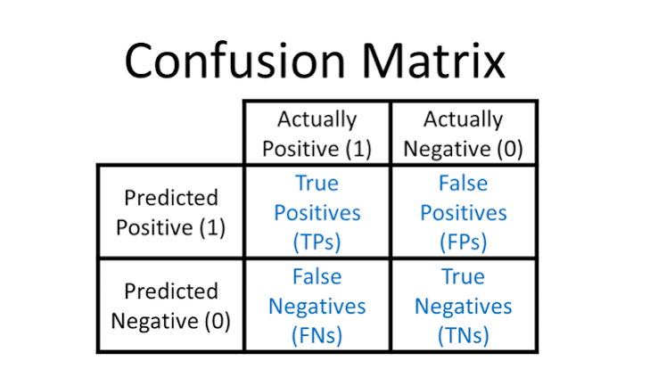

1. Title Name:

Diabetes Prediction Using Machine Learning

2. Project Overview

This project uses machine learning to predict the likelihood of diabetes based on patient health measurements.

The goal is to build a model that learns patterns from historical data and predicts whether a person may be at risk of diabetes.

Note: This project is for educational purposes and is not a substitute for professional medical diagnosis.

3. Objectives

Load and explore the diabetes dataset.

Clean and preprocess the data.

Perform exploratory data analysis (EDA).

Train a machine learning classification model.

Evaluate the model using suitable performance metrics.

Make predictions on new input data.

4. Technologies Used

Python

Pandas and NumPy

Matplotlib and Seaborn

Scikit-learn

Jupyter Notebook (if applicable)

5. Project Structure

diabetes-prediction/
├── images/
├── train_model.py
├── predict.py
├── requirements.txt
├── README.md
└── .gitignore

Update this structure to match the actual files in your project.

6. Dataset

Describe your dataset source, the number of records, the features, and the target column.

Do not upload private or sensitive patient data. If the dataset comes from an external source, include its source and applicable usage terms.

7. Installation

a. Create a virtual environment:

    python -m venv .venv

b. Activate it in Windows PowerShell:

    .\.venv\Scripts\Activate.ps1

c. Install dependencies:

    pip install -r requirements.txt

d. Clone the repository:

    git clone YOUR_GITHUB_REPOSITORY_URL

    cd YOUR_REPOSITORY_NAME

8. How to Run

Update these commands to match the actual entry point of your project.

Train the model:

    python train_model.py

Run predictions:

    python predict.py

9. Project Images and Results

Exploratory Data Analysis

Model Evaluation

Replace the example filenames above with the actual image paths in your images/ folder.

For example, if your file is images/confusion_matrix.png, write:

To display two images side by side, you can use HTML in your README:

  
  

Make sure the filenames and capitalization match exactly.

10. Model Evaluation

Report the metrics obtained from your actual experiment, such as:

Accuracy

Precision

Recall

F1-score

Confusion matrix

Do not add results until you have measured them.

11. Limitations

Predictions depend on the quality and representativeness of the dataset.

Model performance may differ across populations.

Predictions should not be used alone to make medical decisions.

12. Future Improvements

Compare multiple classification algorithms.

Improve validation and model evaluation.

Add a web interface using Streamlit or FastAPI.

Containerize the application using Docker.

Deploy the application with appropriate monitoring.

13. License

Add a suitable license if you intend to share or reuse this project publicly.
